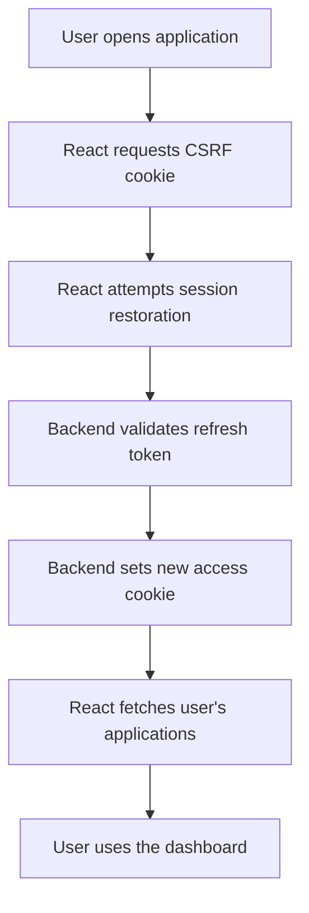
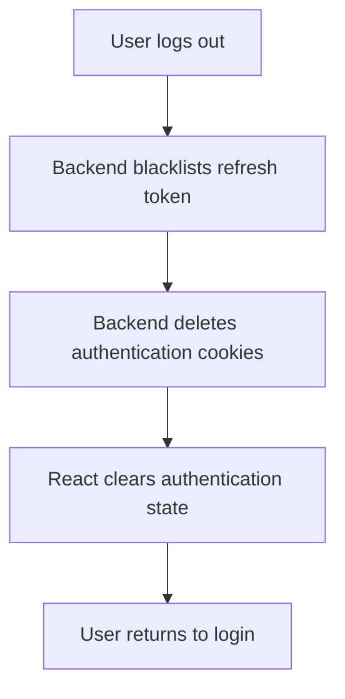

# Authentication Flow

## Purpose

This document explains how authentication works
between the React frontend and Django REST Framework backend.

The system uses JWT authentication stored in HttpOnly cookies.

The backend is responsible for authenticating users
and protecting application data.

